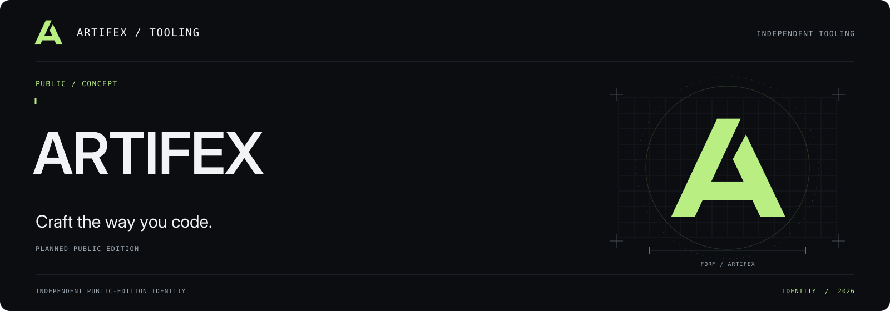
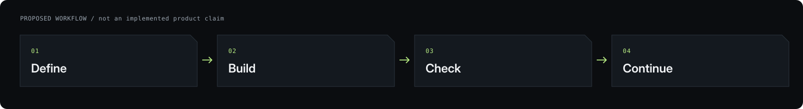

<picture>
  <source media="(prefers-color-scheme: dark)" srcset="docs/assets/brand/banner-dark.svg">
  <source media="(prefers-color-scheme: light)" srcset="docs/assets/brand/banner-light.svg">
  
</picture>

# Artifex

Artifex is a planned, provider-neutral toolbox for agent-assisted software engineering.

It aims to make a team's working conventions portable across coding assistants and projects: how
work is planned, checked, reviewed and handed over. The project will generalise the reusable parts
of Godfrey Engineering's internal toolbox into an independent public tool.

[Project scope](docs/scope.md) · [Roadmap](ROADMAP.md) · [Contributing](CONTRIBUTING.md) ·
[Brand assets](docs/branding.md)

> [!NOTE] This repository contains the project scope, identity and development plan. There is no
> installable implementation or release yet.

## Intended workflow

<picture>
  <source media="(max-width: 600px) and (prefers-color-scheme: dark)" srcset="docs/assets/brand/workflow-mobile-dark.svg">
  <source media="(max-width: 600px)" srcset="docs/assets/brand/workflow-mobile-light.svg">
  <source media="(prefers-color-scheme: dark)" srcset="docs/assets/brand/workflow-dark.svg">
  <source media="(prefers-color-scheme: light)" srcset="docs/assets/brand/workflow-light.svg">
  
</picture>

The intended foundation is a shared project brief and working rules, with adapters for each
supported assistant. Checks should report what they actually verified. Handoffs should preserve
decisions and unfinished work so another session can continue.

These are design goals. Provider support, commands and installation methods will be documented
alongside a tested implementation.

## Start here

Read the [scope](docs/scope.md) for the public boundary and the [roadmap](ROADMAP.md) for the first
implementation milestones. Contributions can begin with concrete workflow problems and small design
proposals. There is no runtime to install or application to run at this stage.

## Repository map

| Path                                     | Purpose                                              |
| ---------------------------------------- | ---------------------------------------------------- |
| [docs/scope.md](docs/scope.md)           | Product intent and generalisation requirements.      |
| [ROADMAP.md](ROADMAP.md)                 | Ordered delivery milestones and acceptance criteria. |
| [docs/branding.md](docs/branding.md)     | Identity, colours and asset usage.                   |
| [docs/assets/brand/](docs/assets/brand/) | Standalone SVG identity assets.                      |
| [CONTRIBUTING.md](CONTRIBUTING.md)       | How to propose and validate changes.                 |

## Licence

[MIT](LICENSE). Copyright © 2026 Godfrey Engineering Ltd.
